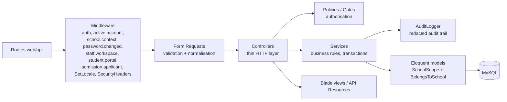
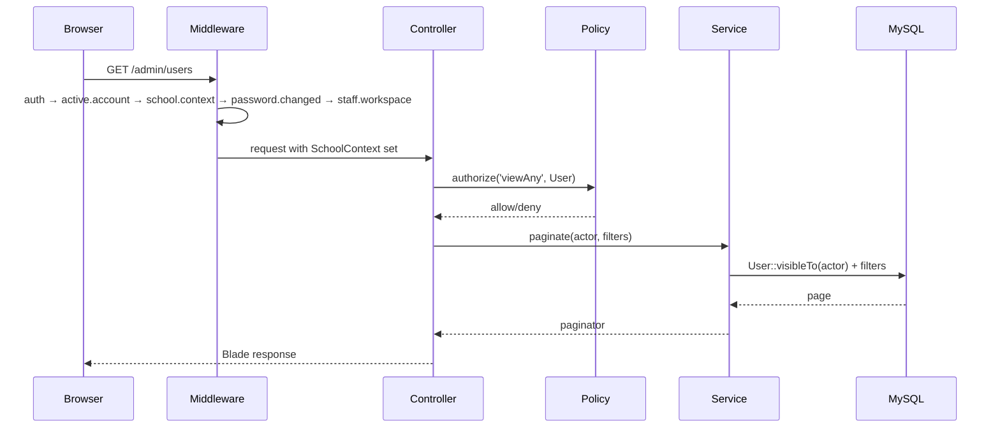

# EduNest Architecture

EduNest is a **single-school** management system for Bangladesh. One installation
serves exactly one school; every account, student and financial record belongs to
that school. There are no tenants, subscriptions, platform administrators or
school-switching flows.

## 1. Technology

| Layer | Choice | Notes |
| --- | --- | --- |
| Runtime | PHP 8.2+ | Tested on PHP 8.2.12 (XAMPP) |
| Framework | Laravel 12 | Stable major, PHPUnit 11 |
| Database | MySQL 5.7+ / MariaDB 10.4+ | Normalised schema, InnoDB, foreign keys |
| Web UI | Blade + Bootstrap 5.3 + Bootstrap Icons | Bootstrap and Chart.js are vendored in `public/assets`; no Node build is required |
| API | Laravel Sanctum 4 | Bearer tokens, versioned under `/api/v1` |
| RBAC | spatie/laravel-permission 6 | Roles are global definitions; data scoping is enforced separately |
| Tests | PHPUnit 11 | Feature tests against a real MySQL test database |

There is no public SaaS sign-up. Accounts are created by authorised school staff.

## 2. Layered structure



Rules followed throughout the codebase:

- Controllers stay small; reusable rules live in `app/Services` and `app/Support`.
- Every write path validates through a Form Request and re-checks authorisation in a
  policy or service. Client-supplied `school_id` is never trusted.
- Multi-table mutations run inside `DB::transaction` and lock affected rows where the
  outcome depends on current state.
- Audit entries are written through one logger that redacts secrets.

### Directory map

```
app/
  Http/Controllers/            Web + Api/V1 controllers
  Http/Middleware/             Account, school context, staff workspace, student portal, applicant desk, locale, headers, password gate
  Http/Requests/               Admin, Exams, Finance, Api, Auth, Profile validation
  Http/Resources/              API serialisation
  Models/                      Eloquent models, Scopes/SchoolScope
  Models/Concerns/             BelongsToSchool (scope + school_id auto-fill)
  Policies/                    UserPolicy, SchoolPolicy
  Services/                    Authentication, User, School, Dashboard, academic/student/staff/attendance, fees, exams/results
  Support/                     SchoolContext, RoleHierarchy, AuditLogger, FileUploadService, ApiResponse
  Notifications/               WelcomeNotification (database channel)
config/school.php              Roles, workspace roles, permissions, uploads, locales, demo policy
database/migrations/           Full schema for every planned module
database/seeders/              Roles/permissions + one-school local demo data
lang/bn/ and lang/bn.json      Bengali framework and UI translations
public/assets/                 Vendored CSS, JS, fonts, Bootstrap, Chart.js
resources/views/               Blade layout, partials, pages
docs/                          This documentation set
tests/Feature/                 Auth, scoping, users, academics, students, staff, attendance, fees, exams, landing, API
```

## 3. Single-school workspace and scoping

The `schools` table holds exactly one row. School-owned tables still carry a
non-null `school_id` foreign key. This is **not multi-tenancy**; it is an
integrity and defense-in-depth boundary so that every record is provably owned
by the school, policies can check ownership, and a future data import or
reporting job cannot accidentally mix records.

### 3.1 The context object

`App\Support\SchoolContext` is a request-scoped singleton holding the active
school id for the current request.

`App\Models\Concerns\BelongsToSchool`:

1. registers `SchoolScope` as a global scope;
2. fills `school_id` from the context on `creating` when not already set;
3. provides `school()` and `withoutSchoolScope()` helpers.

`SchoolScope` adds `where table.school_id = ?` whenever a context is active.

### 3.2 Context resolution (`ResolveSchoolContext`)

| Actor | Context source |
| --- | --- |
| Guest | none |
| Authenticated staff/student | `user.school_id` |
| Account without a school | rejected with 403 |

The middleware never reads a client-supplied school id, session key or header.
It derives the context from the authenticated account only. There is no route,
form field or API header that can change the school.

The guest landing page has no authenticated actor. `LandingController` loads the
single school and wraps its aggregate count queries in
`SchoolContext::run($school->id, ...)`, so public statistics are explicitly scoped
rather than relying on ambient state. The same scoped load supplies only active
teachers and active classes/sections for the public landing sections; no contact
details or anything beyond the public profile fields are exposed. Authenticated
visitors are redirected to their role workspace before any landing data is loaded.

### 3.3 Deliberate unscoped reads

A query may drop the scope only for maintenance or reporting code reviewed as
such; `withoutGlobalScope(SchoolScope::class)` must be justified in a comment
and covered by a regression test. Normal controllers must never bypass it.

`User` is not globally scoped because authentication must be able to find an
account before the context exists. `User::visibleTo($actor)` and
`UserService::paginate()` filter by the actor's `school_id` explicitly, so the
user directory follows the same rule as other school-owned models.

### 3.4 Writing school-owned rows

Services set `school_id` from the authenticated actor, not from request input.
Mass assignment cannot set `school_id` on `User`; `UserService` assigns it
explicitly via `resolveSchoolIdForCreate()`, which returns the actor's school and
throws if the actor has none.

## 4. Authentication and sessions

- **Web:** Laravel session guard; login form posts to `LoginController`.
- **API:** Sanctum personal access tokens via `POST /api/v1/auth/login`.
- Successful and failed sign-ins are audited. `last_login_at` is updated on success.
- `EnsureAccountIsActive` rejects deactivated users on every protected request and
  invalidates their web session.
- Deactivation, deletion and administrative password resets revoke API tokens and delete
  database sessions for that user.
- `EnsurePasswordIsChanged` redirects users holding a temporary password to the password
  page; the API returns `403 password_change_required`.
- Password reset uses Laravel's broker with a generic response so account existence is
  not disclosed.
- Rate limits: login 5/min per email+IP, password reset 3/min, API 60/min per user/IP
  (`AppServiceProvider`). The login service also tracks failures.

## 5. Authorisation model

- Roles: `school_admin` (90), `principal` (70), `accountant` (60), `teacher` (50),
  `student` (20), from `config/school.php`.
- Three browser workspaces, each with its own middleware alias.
  `config('school.workspace_roles')` lists the roles allowed into `/admin`
  (school admin, principal, accountant, teacher); `EnsureStaffWorkspace`
  (`staff.workspace`) rejects everyone else.
- `EnsureStudentPortal` (`student.portal`) gates `/student` and requires the `student`
  role **and** a linked `students.user_id` row. Portal queries
  always start from `$request->user()->student()`.
- `EnsureAdmissionApplicant` (`admission.applicant`) gates `/admissions`, the desk where
  a registered applicant submits and tracks applications. It admits `student`-role
  accounts whether or not a student record exists yet, which is what separates an
  applicant from an enrolled student: `homeRouteName()` returns `applicant.dashboard`
  before approval and `student.dashboard` after it.
- The three middlewares share `RedirectsToOwnWorkspace`, so a wrongly placed account is
  returned to its own home for browser navigation and receives `403` for JSON. Nothing
  is ever rendered or written in the wrong workspace.
- Permission names are stable contracts (`users.view`, `school.update`, ...). Later
  phases append to the catalogue instead of renaming existing entries.
- Only the School Admin may edit the permission matrix; nobody can assign a role at or
  above their own level.
- `RoleHierarchy` enforces "you cannot manage or assign a role at or above your level".
  `UserPolicy` combines permissions, school equality and hierarchy.
- The last active School Admin cannot be deactivated, demoted or deleted.
- Student accounts receive no staff data: the staff workspace rejects them and the
  portal only exposes their own attendance, invoices and receipts.

## 6. Request lifecycle (web)



API requests use the same middleware chain minus sessions; failures are rendered as a
consistent JSON envelope. The workspace middlewares follow one contract: an unauthenticated
caller to a `student`-facing or applicant page is redirected to `/login` for a browser and
gets `401 Unauthenticated` when it asks for JSON, while an account from another workspace
gets `403` for JSON and a redirect home in a browser.

## 7. API response contract

`App\Support\ApiResponse` produces:

```json
{ "success": true, "message": "OK", "data": {}, "meta": {} }
```

```json
{ "success": false, "message": "Forbidden", "errors": {}, "code": "forbidden" }
```

`bootstrap/app.php` converts validation, authentication, authorisation, not-found and
throttling exceptions into that envelope for `api/*`. Pagination is wrapped as
`meta.pagination` plus `meta.links`. See [API.md](API.md).

## 8. Dashboard and UI shell

- `DashboardService` aggregates counts, month-over-month growth, a 12-month admission
  chart and recent audit activity. Every query is naturally scoped by `SchoolScope`.
- `AppShellComposer` supplies the authenticated user, school and unread counts.
- The staff workspace lives under `/admin`; `/admin` itself redirects to the dashboard.
- The layout is server-rendered: collapsible sidebar, top bar, language switcher,
  notifications and profile menu.
- Bootstrap, Bootstrap Icons, Chart.js and fonts are vendored; production does not
  depend on a CDN or a Node build.
- UI strings use `__()`. Bengali is provided by `lang/bn.json` (UI) and `lang/bn/*.php`
  (validation, auth). Audit descriptions are stored in the language active when the
  event occurred.
- Forms use server-side validation with accessible error summaries; destructive actions
  use confirmation dialogs.

## 9. Audit trail

`App\Support\AuditLogger` writes to `audit_logs` with actor, school, event, morph target,
before/after values, IP and user agent. It recursively redacts password/token/secret
keys. Events include sign-in/out, failed sign-in, user CRUD, status changes, password
resets and changes, profile updates, role matrix updates, school profile updates,
academic changes, admissions, staff/leave/salary changes and attendance changes.

Audit visibility: staff see their own school's entries only.

## 10. Data protection and uploads

- `FileUploadService` accepts only JPEG/PNG/WebP verified by MIME, stores under
  `public/uploads/{profile}/{owner}` with UUID filenames. The public logo/avatar
  profiles are intentional.
- Student and teacher photos are school records. Until a private-disk/signed-route
  design ships, access is limited by unguessable filenames; this is recorded as a
  security follow-up in [SECURITY.md](SECURITY.md).
- Secrets live in `.env`; demo credentials are gated to `local`/`testing` only.

## 11. Extension points

The schema reserves the integration surfaces required by the brief:

- `sms_logs` — outbound SMS queue/audit;
- `payment_gateway_transactions` — gateway callbacks linked to invoices/payments;
- `settings` — typed school configuration;
- `notifications` — database notifications for users, extensible to mail/SMS;
- `backup_logs` — backup runs;
- tables for fees, accounting, exams, timetable, homework, notices, library,
  transport and inventory;
- the `student` role powers the portal; the parent role is intentionally absent
  because this build has no parent workspace.

Service-layer boundaries mean SMS, gateway and portal work can be added without
duplicating fee or enrolment logic.

## 12. Testing strategy

Feature tests run against MySQL (`school_ms_test`) so real foreign keys, scopes and
transactions are exercised. The suite covers:

- login, rate limiting, inactive users, temporary passwords, sign-out, reset privacy;
- school scope isolation, context resolution, profile access and audit scoping;
- staff-workspace gating (staff allowed, students rejected);
- student portal access (linked account required, own records only, cross-student
  404s, temporary-password gate, login redirect);
- user listing, creation, cross-school denial, role hierarchy, self-protection,
  last-admin protection;
- academic setup, admissions/students, staff/leave/salary, attendance reports;
- fee invoice generation, payment idempotency, receipt snapshots and reversals;
- staff fee screens: permission gates, dues, receipt views, export gating and
  cross-school 404s;
- API login, token revocation, pagination, 403 envelope, server-side school resolution;
- profile updates, password rotation, locale switching.

Last verified run: **98 tests, 484 assertions, all passing** against MariaDB
`school_ms_test`.

## 13. Architectural decisions and trade-offs

| Decision | Rationale | Consequence |
| --- | --- | --- |
| Singleton school with `school_id` FKs | Integrity, policy checks and safe reporting without tenant complexity | Every school-owned row still carries and checks the FK |
| School derived from the account | Eliminates IDOR and context-switching bugs | Accounts without a school cannot use the app |
| Global role definitions | Consistent RBAC | The school cannot invent custom roles in v1 |
| `/admin` prefix + workspace-role gate | Clear separation from the student portal | Student routes live under `/student` with their own middleware |
| Server-rendered Blade + vendored assets | Works on shared hosting/XAMPP, no Node runtime | Less SPA interactivity; acceptable for admin workflows |
| Explicit `staff.workspace` middleware | One place to control staff-only access | New staff roles must be added to `config/school.php` |
| Database queue/sessions/cache | Zero extra services on day one | Requires the `jobs`, `sessions` and `cache` tables; scale-out needs Redis later |
| Financial schema with snapshot receipts | Immutable receipts, auditable reversals | Fee services must uphold the invariants documented in [DATABASE.md](DATABASE.md); the staff UI exposes only permission-gated, school-scoped operations |
| Reports read `fee_payment_allocations`, not `fee_payments` | A receipt can cover several fee records, so the allocation grain is the only one where cash sums to the money taken | `FeeReportService` sums received money per allocation and the standard fee per distinct invoice, so neither figure can double-count the other; PDF output is the browser's own print of the report screen |
