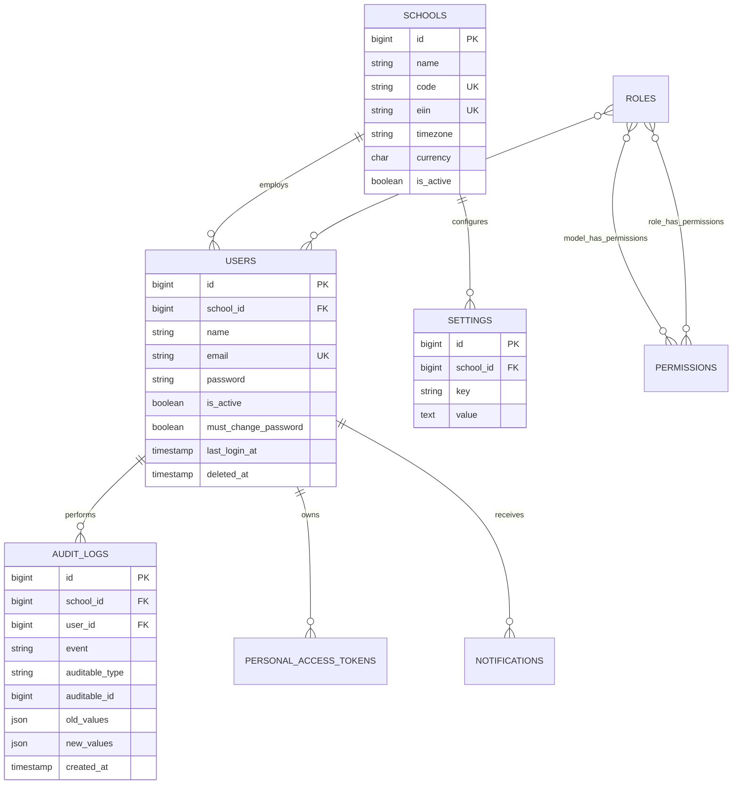
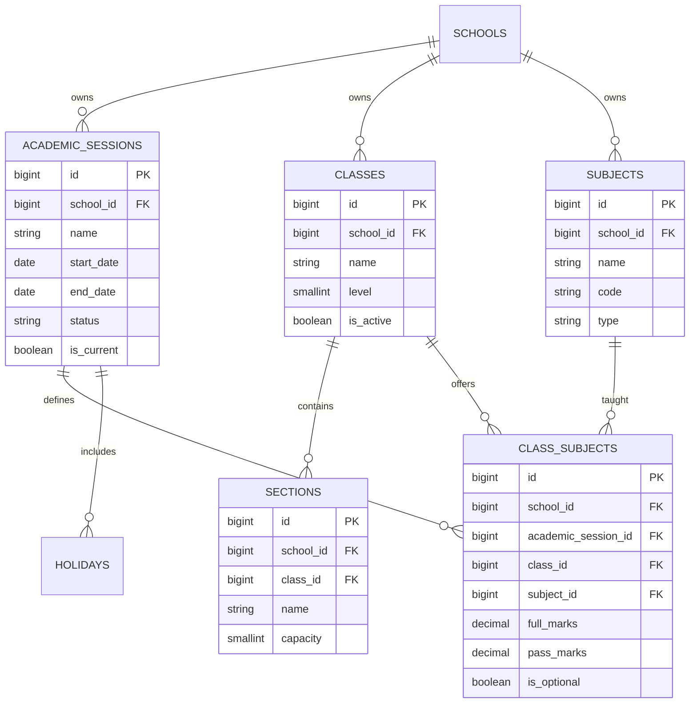
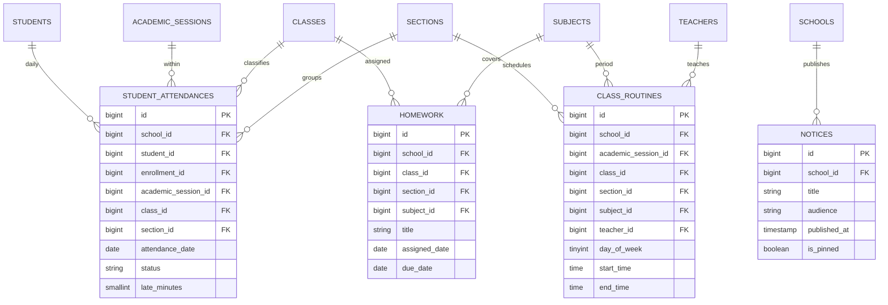
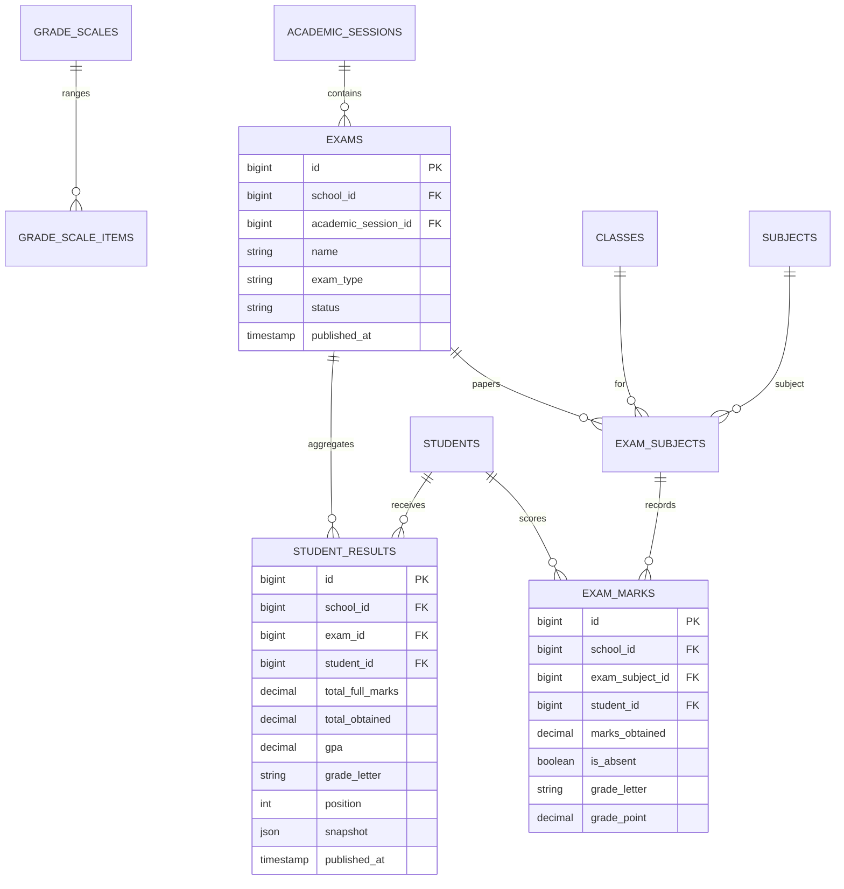
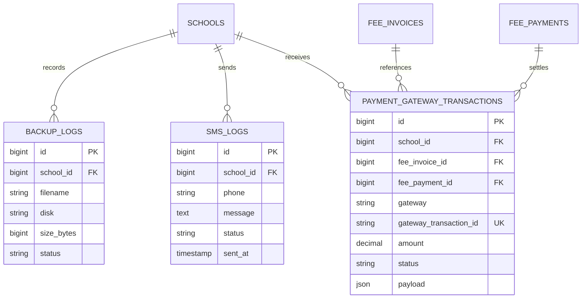

# Database Guide

EduNest ships the full schema for all planned modules. The identity, school, RBAC, audit,
academic, student, staff and attendance tables are used by the implemented features; the
remaining tables are ready for their implementation phases. This guide is the reference
for table purpose, relationships and the invariants that application code must uphold.

## 1. Conventions

- **Single school:** `schools` holds exactly one row. Every school-owned table still has
  `school_id` with a foreign key to `schools`; this is an ownership/integrity boundary,
  not multi-tenancy. Only `schools` itself and framework/RBAC tables have no school key.
  `users.school_id` is nullable at the schema level so authentication can run before a
  context exists, but application policy requires every usable account to have one.
- **Uniqueness is school-scoped:** e.g. `students_school_student_id_unique`,
  `fee_invoices_school_no_unique`, `fee_payments_idempotency_unique`.
- **Money:** `decimal(14,2)` for invoice/payment/cash totals; `decimal(12,2)` for salary
  components, fee amounts and unit prices. Never floats.
- **Rates and marks:** marks `decimal(6,2)`, percentages `decimal(5,2)`, grade points
  `decimal(3,2)`.
- **Referential actions:** master data uses `restrictOnDelete`; pure child rows use
  `cascadeOnDelete`; actor references use `nullOnDelete`; school ownership uses
  `restrictOnDelete`.
- **Soft deletes:** identity/master records (`schools`, `users`, `students`,
  `guardians`, `teachers`, `employees`, `classes`, `sections`, `subjects`, `fee_types`,
  `homework`, `notices`). Financial and attendance rows are never soft-deleted silently;
  corrections use status/reversal fields.
- **Timestamps:** dates use `date`, event times use `timestamp`, clock times use `time`.
  Application timezone is `Asia/Dhaka`.
- **Names:** stored as English text.

## 2. Table catalogue

### Core and access control

| Table | Purpose | Key constraints |
| --- | --- | --- |
| `schools` | The single school's identity, contact, locale/currency, active flag | `code`, `slug`, `eiin` unique; soft deletes; exactly one row |
| `settings` | Typed school key/value configuration | unique `(school_id, key)` |
| `users` | Sign-in accounts; `school_id` required by application policy | `email` unique; soft deletes; indexes on `(school_id, is_active)` and `(school_id, deleted_at)` |
| `password_reset_tokens` | Broker tokens | `email` primary key |
| `sessions` | Database web sessions | `user_id` indexed |
| `personal_access_tokens` | Sanctum API tokens | token hash unique |
| `roles`, `permissions`, `model_has_roles`, `model_has_permissions`, `role_has_permissions` | Spatie RBAC; roles are global | standard Spatie schema |
| `audit_logs` | Immutable administrative/security trail | indexes on school/date, user/date, event/date, morph target |
| `notifications` | Database notifications | UUID primary key, morph notifiable |
| `cache`, `cache_locks`, `jobs`, `job_batches`, `failed_jobs` | Framework infrastructure | Laravel defaults |

### Academic structure

| Table | Purpose | Key constraints |
| --- | --- | --- |
| `academic_sessions` | Year/session definitions; exactly one `is_current` per school is maintained by the service | unique `(school_id, name)` |
| `classes` | Class levels (Play–Class 10) with Bangla name | unique `(school_id, name)`; soft deletes |
| `sections` | Sections within a class | unique `(class_id, name)`; soft deletes |
| `subjects` | Subject catalogue | unique `(school_id, name)`, unique `(school_id, code)`; soft deletes |
| `class_subjects` | Curriculum per session/class with marks | unique `(school_id, session, class, subject)` |
| `holidays` | Closures for attendance/timetable | indexed by school and date range |

### Students and admissions

| Table | Purpose | Key constraints |
| --- | --- | --- |
| `students` | Learner identity and contact; optional one-to-one portal account (`user_id`) | unique `(school_id, student_id)` and `(school_id, admission_no)`; unique `user_id`; soft deletes |
| `guardians` | Guardian contact details; `user_id` reserved, guardian portal not in scope | indexed by school/phone and school/email |
| `student_guardians` | Many-to-many with primary/emergency flags | unique `(student_id, guardian_id)` |
| `admissions` | Application pipeline before a student exists; carries the applicant account (`user_id`, null for office walk-in entries), the applicant photo and the applicant-visible `rejection_reason` | unique `(school_id, application_no)`; optional `student_id` after approval; indexed on `(school_id, user_id)` and `(school_id, user_id, academic_session_id)` |
| `enrollments` | Per-session class/section/roll history | unique `(school_id, student, session)`; unique roll per class/section/session |

### Staff

| Table | Purpose | Key constraints |
| --- | --- | --- |
| `teachers` | Teaching staff, optional user link | unique user, unique `(school_id, employee_code)`; soft deletes |
| `employees` | Non-teaching staff, optional user link | same pattern |
| `leave_types` | Leave catalogue with yearly cap | unique `(school_id, name)` and `(school_id, code)` |
| `staff_leaves` | Requests and approvals | one of teacher/employee; indexed by status/date |
| `staff_attendances` | Daily staff attendance | one row per teacher/date or employee/date |
| `salary_structures` | Effective-dated salary components | indexed by staff and active flag |
| `salary_payments` | Monthly salary with reversal fields | unique `(school_id, teacher, salary_month)` and employee equivalent |

### Attendance, timetable and communication

| Table | Purpose | Key constraints |
| --- | --- | --- |
| `student_attendances` | One row per student per day | unique `(school_id, student, date)`; fast class/date index; `source`/`locked_at` for corrections |
| `student_attendance_cards` | Hashed QR card tokens per student | unique `token_hash`; active-cards index |
| `attendance_devices` | Fingerprint/face terminal registry | hashed secret only; indexed kind/status |
| `attendance_device_users` | Device user ID to student mapping | unique `(device, device_user_id)` and `(device, student)` |
| `attendance_events` | Idempotent QR/device event log | unique `(school_id, source, external_ref)`; status/time indexes |
| `class_routines` | Weekly periods | unique `(section, day, start_time)`; teacher/day index |
| `homework` | Assignments with due date and attachment | `draft`/`published`/`cancelled` status; indexed class/section/due date; soft deletes |
| `study_materials` | Shared files and day-to-day classwork | `kind` = `material` or `classwork`, optional lesson date; period and recent indexes; soft deletes |
| `notices` | Audience-targeted announcements | indexed audience/publish date; soft deletes |

### Fees and receipts

| Table | Purpose | Key constraints |
| --- | --- | --- |
| `fee_types` | Fee catalogue and frequency | unique `(school_id, code)` and `(school_id, name)`; soft deletes |
| `fee_discounts` | Reusable fixed/percentage discounts | unique `(school_id, code)` |
| `fee_structures` | Amount per session/class/fee type | unique `(school_id, session, class, fee_type)` |
| `fee_invoices` | Student invoice with totals and status; `waived_total` is settled, not owed | unique `(school_id, invoice_no)`; indexes status/due and student/status |
| `fee_invoice_items` | Invoice lines | cascade with invoice |
| `fee_invoice_discounts` | Applied discount snapshot per invoice | cascade with invoice |
| `fee_payments` | Money received, allocated to invoices | unique `(school_id, idempotency_key)`; reversal fields |
| `fee_receipts` | **Immutable** receipt snapshot, hash and number | one per payment; unique `(school_id, receipt_no)` |
| `fee_payment_allocations` | Payment-to-invoice allocation; `waived_amount` records a settlement write-off, never a due | unique `(payment, invoice)` |

### Accounting

| Table | Purpose | Key constraints |
| --- | --- | --- |
| `expense_categories` | Expense classification | unique `(school_id, code)` |
| `expenses` | Approved expenses with cancellation fields | unique `(school_id, expense_no)` |
| `cash_transactions` | Cash-in/out ledger; links to source via morph columns and reversal-of | indexed by date/type and reconciliation |

### Examinations

| Table | Purpose | Key constraints |
| --- | --- | --- |
| `grade_scales` | Named grading schemes | unique `(school_id, name)`; one default |
| `grade_scale_items` | Grade ranges and points | unique `(scale, grade_letter)` |
| `exams` | Exam definition and publish state | unique `(school_id, session, name)` |
| `exam_subjects` | Subject papers, dates and marks | unique `(exam, class, subject)` |
| `exam_marks` | Mark per student/paper | unique `(exam_subject, student)` |
| `student_results` | Aggregated GPA/position with published snapshot | unique `(exam, student)` |

### Integration and operations

| Table | Purpose |
| --- | --- |
| `sms_logs` | Outbound SMS content, provider and status |
| `payment_gateway_transactions` | Gateway transaction and payload, linked to invoice/payment |
| `backup_logs` | Backup filename, disk, size, status |

## 3. ER diagrams

### 3.1 Core, RBAC and audit



`audit_logs.school_id` is nullable only for CLI/bootstrap actions performed before a
school exists; normal entries carry the school. `user_id` becomes null if the actor is
deleted. Spatie tables are elided.

### 3.2 Academic structure



### 3.3 Students, guardians, admissions and enrolment

```mermaid
erDiagram
    SCHOOLS ||--o{ STUDENTS : enrols
    STUDENTS ||--o{ STUDENT_GUARDIANS : has
    GUARDIANS ||--o{ STUDENT_GUARDIANS : protects
    USERS ||--o| STUDENTS : portal_account
    USERS ||--o{ ADMISSIONS : submits
    ACADEMIC_SESSIONS ||--o{ ADMISSIONS : receives
    CLASSES ||--o{ ADMISSIONS : applied_for
    STUDENTS ||--o| ADMISSIONS : converted_to
    STUDENTS ||--o{ ENROLLMENTS : history
    ACADEMIC_SESSIONS ||--o{ ENROLLMENTS : within
    CLASSES ||--o{ ENROLLMENTS : places
    SECTIONS ||--o{ ENROLLMENTS : groups

    STUDENTS {
        bigint id PK
        bigint school_id FK
        bigint user_id FK_UK
        string student_id
        string admission_no
        string first_name
        string last_name
        date date_of_birth
        string status
        date admission_date
    }
    GUARDIANS {
        bigint id PK
        bigint school_id FK
        bigint user_id FK "reserved"
        string name
        string relation
        string phone
        string nid
    }
    STUDENT_GUARDIANS {
        bigint id PK
        bigint school_id FK
        bigint student_id FK
        bigint guardian_id FK
        boolean is_primary
        boolean is_emergency_contact
    }
    ADMISSIONS {
        bigint id PK
        bigint school_id FK
        bigint user_id FK
        bigint academic_session_id FK
        bigint applied_class_id FK
        string application_no
        string status
        string photo_path
        text rejection_reason
        bigint student_id FK
    }
    ENROLLMENTS {
        bigint id PK
        bigint school_id FK
        bigint student_id FK
        bigint academic_session_id FK
        bigint class_id FK
        bigint section_id FK
        int roll_no
        string status
    }
```

### 3.4 Staff, leave, attendance and salary

```mermaid
erDiagram
    USERS ||--o| TEACHERS : account
    USERS ||--o| EMPLOYEES : account
    LEAVE_TYPES ||--o{ STAFF_LEAVES : categorises
    TEACHERS ||--o{ STAFF_LEAVES : requests
    EMPLOYEES ||--o{ STAFF_LEAVES : requests
    TEACHERS ||--o{ STAFF_ATTENDANCES : marked
    EMPLOYEES ||--o{ STAFF_ATTENDANCES : marked
    TEACHERS ||--o{ SALARY_STRUCTURES : earns
    EMPLOYEES ||--o{ SALARY_STRUCTURES : earns
    SALARY_STRUCTURES ||--o{ SALARY_PAYMENTS : generates
    TEACHERS ||--o{ SALARY_PAYMENTS : paid
    EMPLOYEES ||--o{ SALARY_PAYMENTS : paid

    TEACHERS {
        bigint id PK
        bigint school_id FK
        bigint user_id FK_UK
        string employee_code
        string designation
        date joining_date
        string status
    }
    STAFF_LEAVES {
        bigint id PK
        bigint school_id FK
        bigint leave_type_id FK
        bigint teacher_id FK
        bigint employee_id FK
        date start_date
        date end_date
        decimal total_days
        string status
    }
    STAFF_ATTENDANCES {
        bigint id PK
        bigint school_id FK
        bigint teacher_id FK
        bigint employee_id FK
        date attendance_date
        string status
    }
    SALARY_PAYMENTS {
        bigint id PK
        bigint school_id FK
        bigint salary_structure_id FK
        bigint teacher_id FK
        bigint employee_id FK
        date salary_month
        decimal gross_salary
        decimal net_salary
        string status
        timestamp reversed_at
    }
```

Exactly one of `teacher_id`/`employee_id` is required; this is enforced in the Phase 3
service layer because MySQL unique indexes permit multiple NULLs.

### 3.5 Student attendance, routines and communication



### 3.6 Fees, receipts, expenses and cash

```mermaid
erDiagram
    FEE_TYPES ||--o{ FEE_STRUCTURES : priced
    ACADEMIC_SESSIONS ||--o{ FEE_STRUCTURES : session
    CLASSES ||--o{ FEE_STRUCTURES : class
    FEE_TYPES ||--o{ FEE_DISCOUNTS : discountable
    STUDENTS ||--o{ FEE_INVOICES : billed
    ACADEMIC_SESSIONS ||--o{ FEE_INVOICES : session
    FEE_INVOICES ||--o{ FEE_INVOICE_ITEMS : lines
    FEE_INVOICES ||--o{ FEE_INVOICE_DISCOUNTS : reductions
    FEE_DISCOUNTS ||--o{ FEE_INVOICE_DISCOUNTS : applied
    STUDENTS ||--o{ FEE_PAYMENTS : pays
    FEE_PAYMENTS ||--|| FEE_RECEIPTS : receipt
    FEE_PAYMENTS ||--o{ FEE_PAYMENT_ALLOCATIONS : allocates
    FEE_INVOICES ||--o{ FEE_PAYMENT_ALLOCATIONS : settled_by
    EXPENSE_CATEGORIES ||--o{ EXPENSES : classifies
    CASH_TRANSACTIONS ||--o| CASH_TRANSACTIONS : reverses

    FEE_INVOICES {
        bigint id PK
        bigint school_id FK
        bigint student_id FK
        string invoice_no
        decimal subtotal
        decimal discount_total
        decimal total
        decimal paid_total
        decimal due_total
        decimal waived_total
        string status
    }
    FEE_PAYMENTS {
        bigint id PK
        bigint school_id FK
        bigint student_id FK
        decimal amount
        string method
        string idempotency_key UK
        string status
        timestamp reversed_at
    }
    FEE_RECEIPTS {
        bigint id PK
        bigint school_id FK
        bigint fee_payment_id FK_UK
        string receipt_no UK
        json snapshot
        char snapshot_hash
        timestamp issued_at
    }
    FEE_PAYMENT_ALLOCATIONS {
        bigint id PK
        bigint school_id FK
        bigint fee_payment_id FK
        bigint fee_invoice_id FK
        decimal amount
    }
    EXPENSES {
        bigint id PK
        bigint school_id FK
        bigint expense_category_id FK
        string expense_no
        decimal amount
        date expense_date
        string status
    }
    CASH_TRANSACTIONS {
        bigint id PK
        bigint school_id FK
        string type
        decimal amount
        date transaction_date
        string source_type
        bigint source_id
        bigint reversal_of_id FK
        timestamp reconciled_at
    }
```

`cash_transactions` links to fee payments, salary payments and expenses through
`(source_type, source_id)`. This is polymorphic by design; services must write the ledger
row in the same transaction as the source record.

### 3.7 Examinations



Exam workflow invariants:

- Marks exist only for enrolled students and stay between `0` and the paper's
  `full_marks`; absence is stored as `is_absent = 1` with `marks_obtained` null.
- `grade_letter`/`grade_point` on `exam_marks` are denormalised from the default
  grade scale at entry time so historical marks keep their original grade.
- `student_results` rows are written only during publish, inside a transaction
  that locks the exam row after verifying complete marks for every paper.
- `snapshot` is the immutable published report-card payload (student,
  enrollment, subjects, totals, GPA, grade, position, outcome); unpublishing
  keeps the snapshot but flips `status` back to `draft`.
- Positions are unique per exam/class ranking with ties sharing a position.

### 3.8 Integrations and backups



## 4. Financial invariants (mandatory for Phase 4 services)

These rules are not optional polish; they prevent the silent data corruption the brief
explicitly forbids.

1. **Invoice line:** `line_total = round(quantity * unit_amount - discount_amount, 2)`;
   `discount_amount` may not exceed `quantity * unit_amount`.
2. **Invoice header:** `subtotal = SUM(items.line_total)`;
   `discount_total = SUM(invoice_discounts.amount)`;
   `total = subtotal - discount_total`; neither total nor due may be negative.
3. **Paid/due:** `paid_total = SUM(non-reversed payment allocations)` and
   `due_total = total - paid_total - waived_total`. `paid_total` may never exceed `total`.
   `waived_total` is only ever raised by a payment whose allocation carries a
   `waived_amount`, i.e. a settlement that closed the invoice on the money actually
   received. It is not a balance: it is excluded from `outstanding()`, the dues list,
   every dashboard tile, defaulter report and export.
   Status is derived (`issued`, `partially_paid`, `paid`, `overdue`, `cancelled`) and
   written from the same transaction.
4. **Payment:** `fee_payments.amount = SUM(fee_payment_allocations.amount)` for that
   payment. An allocation may not exceed the invoice's current due.
5. **Idempotency:** every payment requires a client/server-generated
   `idempotency_key`, unique per school. Re-submitting the same key returns the original
   receipt; it must not post a second payment. Use `lockForUpdate()` on the invoice and
   payment rows inside one transaction.
6. **Receipt:** `fee_receipts` is insert-only. It stores a JSON snapshot of payer,
   invoice numbers, amounts, method, timestamp, receiver and school identity, plus a
   SHA-256 `snapshot_hash`. Receipt numbers are unique per school and generated inside
   the payment transaction. Never update or delete a receipt; corrections are reversals.
7. **Reversal:** set the payment `status = reversed`, `reversed_at/by/reason`; insert a
   reversing `cash_transactions` row linked with `reversal_of_id`; recompute affected
   invoices. Never delete a posted payment, receipt or allocation.
8. **Cash reconciliation:** every posted fee payment/salary/expense writes a matching
   `cash_transactions` row. Reconciliation sets `reconciled_at/by`; reconciliation does
   not alter amounts.
9. **Salary:** one payment per staff member per `salary_month`; paid rows are never
   hard-deleted, only reversed with the provided fields.
10. **Expense cancellation:** use `cancelled_at/by/cancel_reason` plus a reversing cash
    entry, not deletion.

Phase 4 acceptance tests must cover partial payments, overpayment rejection,
double-submit, concurrent payment, reversal arithmetic and receipt immutability.

## 5. Deletion policy

| Data | Behaviour |
| --- | --- |
| School | Restrict while owned rows exist; deactivate instead; soft delete |
| User | Soft delete; tokens/sessions revoked; audit retained; last-admin guard |
| Student/guardian/teacher/employee | Soft delete; financial history remains |
| Class/section/subject/fee type | Soft delete; restricted while referenced |
| Attendance | Correct by update; never silently delete posted days |
| Invoice/payment/receipt/allocation | No deletion; reversal/cancellation only |
| Expense/salary/cash | No deletion; cancellation/reversal only |
| Child invoice lines/discounts | Cascade only with an unposted draft invoice |

## 6. Migration order

```
0001_01_01_000000  schools + settings
0001_01_01_000001  users, password_reset_tokens, sessions
0001_01_01_000002  cache
0001_01_01_000003  jobs
2026_10_26_144947  personal_access_tokens
2026_10_26_144953  permission tables (Spatie)
2026_10_26_150000  audit_logs, notifications
2026_10_26_150100  academic_sessions, classes, sections, subjects, class_subjects, holidays
2026_10_26_150200  students, guardians, student_guardians, admissions, enrollments
2026_10_26_150300  teachers, employees, leave_types, staff_leaves, staff_attendances, salary_structures, salary_payments
2026_10_26_150400  student_attendances
2026_10_26_150500  class_routines, homework, notices
2026_10_26_150600  fee_types, fee_discounts, fee_structures, fee_invoices, items, discounts, payments, receipts, allocations
2026_10_26_150700  expense_categories, expenses, cash_transactions
2026_10_26_150800  grade_scales, grade_scale_items, exams, exam_subjects, exam_marks, student_results
2026_10_26_150900  sms_logs, payment_gateway_transactions, backup_logs
2026_10_26_151000  students.user_id portal account link
2026_10_27_000100  notifications metadata (category, dedupe_key)
2026_10_27_000200  notification_preferences
2026_10_27_000300  push_subscriptions
2026_10_27_000400  push_delivery_logs
2026_10_27_000500  device_push_tokens
2026_10_28_000100  admissions.user_id, photo_path, rejection_reason + indexes
2026_10_29_130000  fee_invoices active billing_period unique index
2026_10_29_140000  attendance_submissions; bank_accounts, payment_gateway_log, finance columns
2026_10_29_210000  mark_submissions
2026_10_29_220000  study_materials
2026_10_29_230000  homework.status, homework.published_at
2026_10_29_230100  study_materials.kind, study_materials.work_date
2026_10_30_100000  fee_invoices.waived_total, fee_payment_allocations.waived_amount
```

## 7. Seeded reference data

`php artisan db:seed` always runs `RolePermissionSeeder`. In `local`/`testing` it also
runs `DemoDataSeeder`, creating one school:

- EduNest Model School (ENS): 3 sessions, 10 classes with A/B sections, 7 subjects,
  28 students with guardians and enrolments, 6 teachers, 2 employees.
- A student portal account (`student@edunest.test`) linked to the first enrolled
  student, with 30 attendance days, two invoices, payments and receipts.

Seeders are idempotent by natural keys; student seeding is skipped for a school that
already has students. See [INSTALLATION.md](INSTALLATION.md) for credentials.
